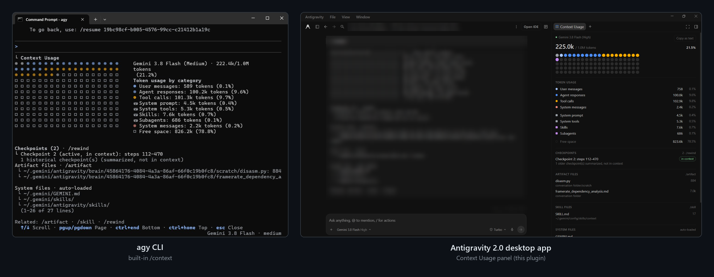

# antigravity-desktop-context

A **Context Usage** side panel for the **Antigravity 2.0 desktop app**, based on the Antigravity CLI's `/context` command.

In contrast to other context monitors, which estimate usage from the conversation's transcript (roughly one token per four characters) and sort it into categories of their own, this panel reads the token breakdown that Antigravity records for every model call, the same data the CLI's `/context` uses. The accounting is ported from the CLI binary itself, so the categories, totals, checkpoints and files match `agy /context` on the same conversation, and the context window and model name come live from the app's model catalog.



## Installation

Requires the Antigravity 2.0 desktop app and Python 3 on your `PATH` (`python`, `py` or `python3`).

1. Clone this repository into your Antigravity plugins folder:

   ```bash
   # macOS / Linux
   git clone https://github.com/dimitr-io/antigravity-desktop-context.git ~/.gemini/config/plugins/desktop-context
   ```

   ```powershell
   # Windows (PowerShell)
   git clone https://github.com/dimitr-io/antigravity-desktop-context.git "$HOME\.gemini\config\plugins\desktop-context"
   ```

2. Restart Antigravity, open **Customizations → Installed**, and turn **Context Usage** on.
3. Open a conversation and open **Context Usage** in the right-side panel.

To update, run `git pull` inside that folder, then turn the plugin off and on again.

## What it shows

The report follows the CLI's `/context` (`cli/model.ContextModel` in agy 1.4.4), ported from the CLI binary:

- **Header**: model name, used/limit tokens and percentage.
- **Usage grid**: each dot is 1% of the context window. Segments, in order: system (prompt + tools + overhead), user messages, agent responses, tool calls, customizations, then free space. Every non-empty segment gets at least one dot.
- **Token usage**: `User messages`, `Agent responses` and `Tool calls` always show; `System messages`, `System prompt`, `System tools`, `System overhead`, `Rules`, `Skills`, `Subagents`, `Legacy workflows`, `Workflows`, `Plugins` and `MCP tools` show only when non-zero. Then `Free space`, and the `Checkpoint buffer` (tokens in checkpoint steps, not counted in usage).
- **Before the first reply, or right after a compaction**: per-step estimates, like the CLI ("Estimated usage (awaiting generation)" / "Estimated after compaction · updates next turn").
- **Checkpoints**: the active checkpoint and how many older ones were summarized.
- **Files**: knowledge and artifact files written by the agent, skill files it opened (with the tokens those steps cost), and the auto-loaded system folders, including the workspace's `.agents/` folders.


## How it works

```
plugin.json               plugin manifest
sidecars/context/
  sidecar.json            registers the side panel (runs main.mjs with Antigravity's Node)
  main.mjs                backend: serves the panel and /api/report
  index.html              the panel (inline CSS and JS)
  context_report.py       the parser
tests/                    parser tests
```

- The panel gets the open conversation's ID and workspace folders from Antigravity's sidecar bridge and asks the backend for a report every 3 seconds.
- The backend runs `context_report.py --json` on the conversation's database (`~/.gemini/antigravity/conversations/<id>.db`, opened read-only), but only when the database has changed. Otherwise it returns the cached report.
- On startup and every 10 minutes, the backend asks the app's language server for its model catalog (`GetAvailableModels`), so the context window and model name come from the app, like in the CLI. If that call fails, the parser falls back to a built-in table (Gemini 1,048,576 · Claude 5.5 1,000,000 · Claude 4.6 250,000 · GPT-OSS 131,072 tokens).

The context window shown is the model's native window, as in the CLI. Each request also has a smaller budget (usually 256,000 tokens): once a conversation passes it, the app trims older history even though the window is larger ([details](https://github.com/lmxxf/antigravity-context-fix)). The parser's `--json` output reports it as `request_budget_tokens`.

## Command line and testing

The parser also runs on its own. It prints the CLI's text report:

```bash
# The most recently active desktop conversation
python sidecars/context/context_report.py

# A specific conversation, with its workspace
python sidecars/context/context_report.py --conversation-id <uuid> --workspace /path/to/workspace

# Any conversation database, e.g. one from the agy CLI; --json for structured output
python sidecars/context/context_report.py --db ~/.gemini/antigravity-cli/conversations/<uuid>.db
```

The test suite needs only the Python standard library. It builds synthetic conversation databases and checks the report end to end:

```bash
python -m unittest discover tests
```

To compare against the real CLI, open a conversation in `agy`, run `/context`, then run the parser with `--db` on the same conversation. The CLI logs the open conversation's ID in `~/.gemini/antigravity-cli/cli.log`, on the latest `Starting conversation update stream for <uuid>` line. The categories, totals, checkpoints and file lists should match.

## License

[MIT](LICENSE)
